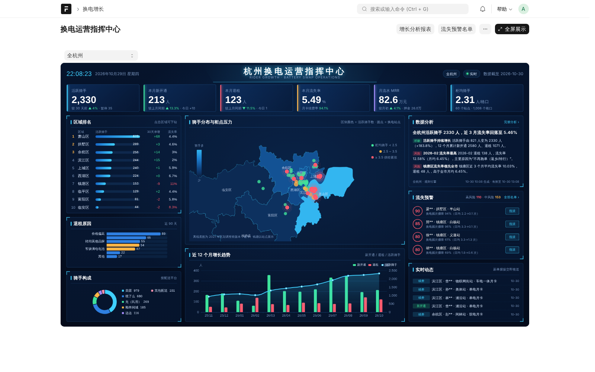
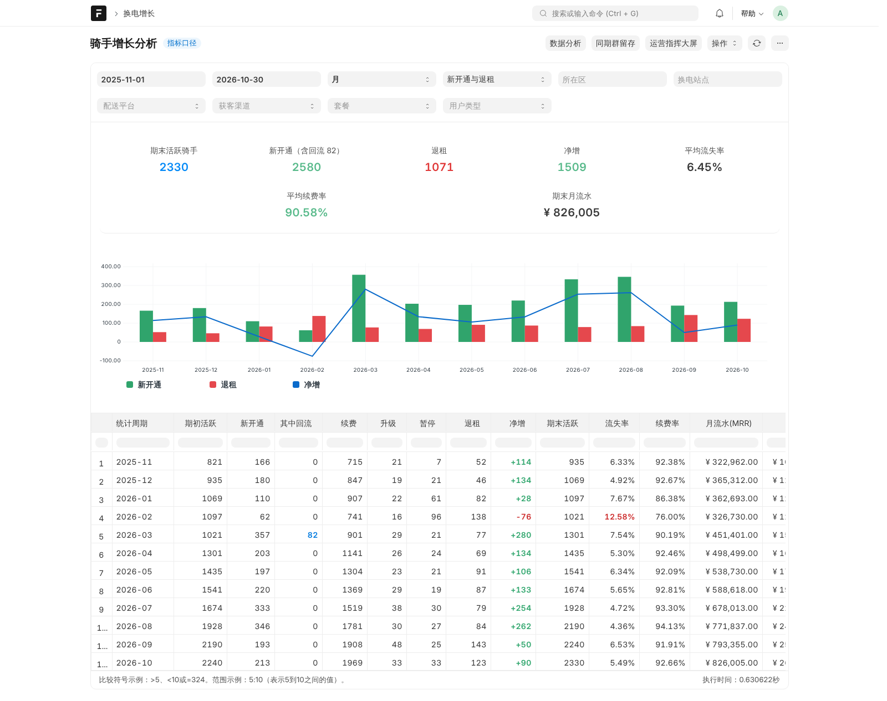
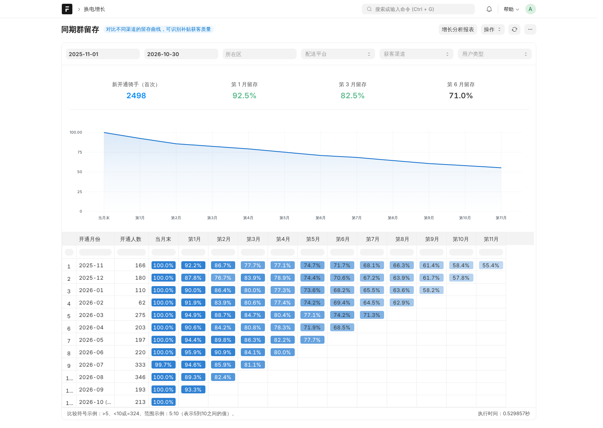
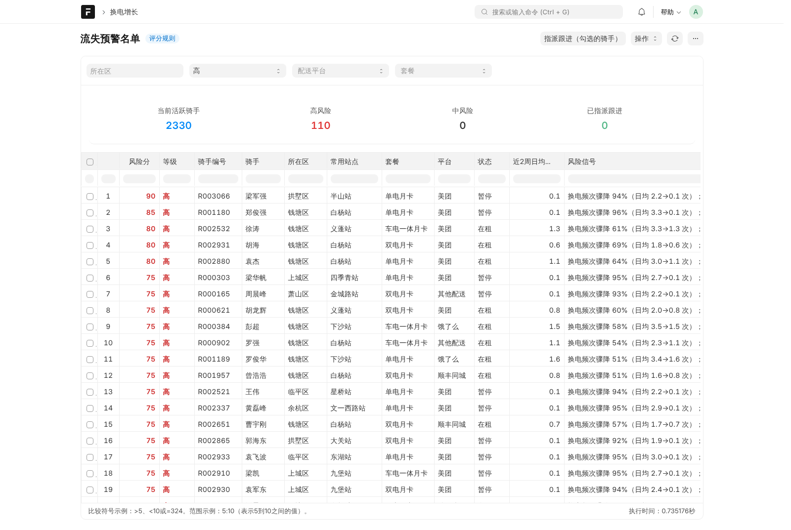
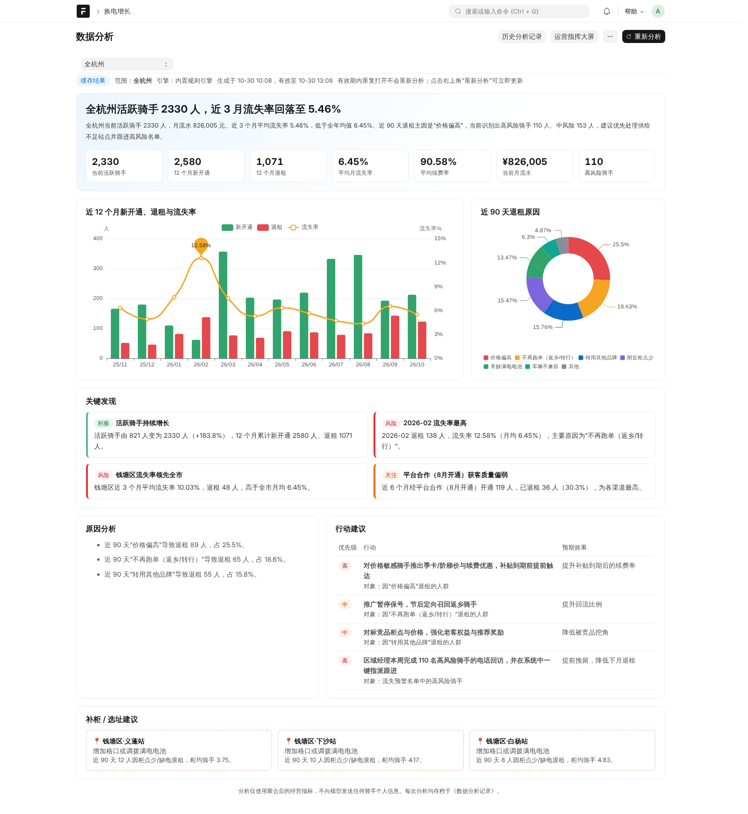

# swap_growth · 换电用户增长分析

基于 **Frappe Framework v15** 的自定义应用，面向两轮电动车**换电运营**场景：骑手（外卖、快递、同城配送为主）按月租用电池，在换电柜扫码换电。应用覆盖从**录单 → 分析 → 大屏 → 预警跟进 → 数据分析**的完整业务闭环。



> 在线演示：`http://<演示地址>/`（部署后更新）
> 演示账号（密码均为 `Swap@2026`）：`director@example.com` 运营总监 · `qiantang.mgr@example.com` 区域经理（仅钱塘、临平）· `operator@example.com` 运营专员

---

## 一、题目要求与交付对应

| 题目要求 | 交付内容 | 位置 |
| --- | --- | --- |
| 用户服务开通/流失单据（DocType）+ 预设 mock 数据 | **骑手服务单**：新开通 / 续费 / 升级套餐 / 暂停 / 退租，可提交、带业务校验；安装即生成 12 个月、约 3,300 名骑手、2 万张单据 | `doctype/rider_service_record` · `demo/generator.py` |
| 用户增长数据报表（Report） | **骑手增长分析**（周/月/季，新增、流失、净增、活跃、流失率、续费率、MRR）；另附 **同期群留存**、**流失预警名单** | `report/` |
| 用户增长数据大屏（Page） | **杭州换电运营指挥中心**：1920×1080 等比缩放、全屏、地图、实时推送 | `page/swap_command_center` |
| 自由发挥 | **数据分析**（DeepSeek / 智谱 GLM，结果缓存 3 小时）、**流失预警 + 一键指派**、**区域数据权限**、中文本地化 | `analysis.py` · `risk.py` |

## 二、业务设计

### 为什么是"换电"场景
两轮换电的收入来自骑手月卡，成本是换电柜和电池等重资产，经营的核心是**骑手留存**和**单柜利用率**。因此本应用把"开通/流失"落到真实的业务语言上：套餐、押金、站点、配送平台、获客渠道、退租原因，而不是一张抽象的用户表。

### 角色与使用逻辑

```
运营专员 ──录入/提交服务单──▶ 骑手服务单（校验生命周期、自动带出画像、计算月费与押金）
                                 │ 提交即实时推送
区域经理 ──每周──▶ 增长报表 / 流失预警名单 ──勾选指派──▶ 跟进任务（Frappe ToDo）
运营总监 ──经营会──▶ 指挥大屏 ──▶ 数据分析（结论 · 原因 · 行动 · 补柜建议）
```

| 角色 | 能看到什么 | 典型动作 |
| --- | --- | --- |
| 换电运营专员 | 录单、查看单据 | 新开通、续费、升级、暂停、退租 |
| 区域经理 | **仅本人负责区域**的单据、报表、大屏、分析（User Permission 自动隔离） | 查看流失、指派高风险骑手跟进 |
| 运营总监 | 全市 | 看大屏、做数据分析、配置模型 |

### 单据规则（骑手服务单）
- 未在租的骑手只能"新开通"；在租骑手不能重复开通；曾退租再开通自动标记为**回流骑手**
- 升级套餐必须高于原套餐，系统自动记录原套餐
- 退租必须填写退租原因（用于流失归因）；押金方式开通的骑手退租后押金状态自动变为"待退还"
- 月费按套餐自动带出；负责人默认为所在区的区域经理；提交后不可修改，需作废后修订
- 录入骑手编号即自动带出该骑手最近一次的画像；新骑手自动分配编号

### 套餐定价
参考杭州两轮换电市场常见价位（单电月卡 230~350 元、车电组合 500 元以上）：

| 套餐 | 月费 | 押金 |
| --- | --- | --- |
| 单电月卡 | 269 元 | 300 元，或信用免押 |
| 双电月卡 | 429 元 | 同上 |
| 车电一体月卡 | 539 元 | 同上 |

## 三、指标口径

| 指标 | 定义 |
| --- | --- |
| 活跃骑手 | 当前状态为"在租"或"暂停"（仍保有服务关系、押金未退）的骑手 |
| 新开通 / 其中回流 | 统计期内的新开通单据；曾经退租后再次开通的计为回流 |
| 流失率 | 本期退租 ÷ 期初活跃骑手（期初为 0 时以本期新开通为分母） |
| 续费率 | 本期续费 ÷（续费 + 退租 + 暂停），即到期骑手中选择续费的比例 |
| 月流水 MRR | 期末在租骑手当前套餐月费之和（暂停骑手不计） |
| 押金沉淀 | 期末活跃且以押金方式开通的骑手押金合计 |
| 柜均骑手 | 活跃骑手 ÷ 运营中站点的格口数，衡量供给压力 |

所有报表、大屏、分析共用 `metrics.py` 中同一套"状态回放"逻辑，保证口径一致。

## 四、演示数据

安装时自动生成（`demo/generator.py`，固定随机种子可复现）：杭州 10 个区、60 个换电站点、约 3,300 名骑手、约 2 万张服务单（含每月续费）、近 8 周换电柜 IoT 周汇总。数据中埋入了四条可以被报表、大屏和数据分析**看出来**的业务剧情：

1. **春节返乡**：1~2 月暂停、退租上升（2 月流失率 12.6%，净增转负），3 月出现回流骑手
2. **萧山民用推广**：3 月起萧山区"政企合作"渠道的民用用户开通逐月放量，萧山柜均骑手随之升高
3. **钱塘区柜点不足**：骑手多、站点少，流失率长期约为全市 1.6 倍，原因集中在"附近柜点少 / 常缺满电电池"
4. **平台补贴**：7~8 月"平台合作"渠道开通激增，9~10 月补贴结束后该批骑手退租上升，原因集中在"价格偏高"

> 演示数据为虚构，剧情为演示设定。可在《换电增长设置》中一键重新生成。

## 五、功能说明

### 1. 增长分析报表


- 筛选：时间、粒度（周/月/季）、区域、站点、平台、渠道、套餐、用户类型
- 顶部 KPI 卡片，四种图表视图（新开通与退租 / 活跃骑手趋势 / 流失率与续费率 / 月流水）
- 指标口径可在页面内查看

### 2. 同期群留存


按首次开通月份分组，观察第 N 个月仍在服务的比例。按"平台合作"渠道筛选，可直观看到补贴获客的留存衰减。

### 3. 运营指挥大屏
- 按 1920×1080 设计，等比缩放，支持全屏，60 秒自动刷新
- 杭州区划地图：区块颜色表示活跃骑手数，站点圆点颜色表示柜均骑手（供给压力），压力最高的站点带涟漪动画
- 区域排名（点击下钻）、退租原因、骑手构成、12 个月趋势、数据分析摘要、流失预警 Top、实时动态
- **服务单提交后通过 Frappe Realtime（socket.io）实时推送到大屏**；菜单中提供"模拟录入一张新单据"便于现场演示

### 4. 流失预警


对当前活跃骑手按透明规则打分（满分 100），每一分都能解释：

| 信号 | 分值 |
| --- | --- |
| 换电频次骤降 ≥50% / 下降 30%~50%（近 2 周 vs 前 4 周，来自换电柜 IoT 周汇总） | +40 / +25 |
| 当前暂停 | +20 |
| 常用站点近 90 天 ≥3 人因柜点少/缺电退租 | +15 |
| 近 150 天经补贴渠道开通 | +15 |
| 所在区近 90 天流失率高于全市 1.3 倍 | +10 |
| 月卡 7 天内到期 | +10 |

≥55 为高风险。勾选后**一键指派**给所在区的区域经理，生成 Frappe 原生 ToDo，出现在对方的待办中。

### 5. 数据分析


- 支持选择分析区域（全杭州或单个区；区域经理只能选自己负责的区）
- 输出：一句话结论、摘要、关键发现、原因分析、行动建议（含优先级与预期效果）、补柜/选址建议，并配统计图表（12 个月新开通/退租/流失率、退租原因构成）
- **结果缓存 3 小时**：有效期内重复打开直接复用，不重复调用模型；超时或点击"重新分析"才重新生成；每次结果存档在《数据分析记录》
- 大模型：**DeepSeek** 或 **智谱 GLM**（OpenAI 兼容接口），在《换电增长设置》中填写 API Key；未配置或调用失败时自动降级为内置规则引擎，演示不中断
- 隐私：只向模型发送聚合后的经营指标，**不发送任何骑手个人信息**

## 六、安装

要求：Frappe v15（Python 3.10+，Node 18+，MariaDB 10.6+）。

```bash
cd frappe-bench
bench get-app https://github.com/lanterner3054/swap_growth
bench --site <your-site> install-app swap_growth   # 自动生成演示数据
bench build --app swap_growth
```

纯 Frappe 新站点安装时，应用会自动完成中文、上海时区、人民币的本地化，并跳过初始化向导。

配置大模型（也可在界面《换电增长设置》中填写）：

```bash
bench --site <your-site> execute swap_growth.setup_tools.configure_llm \
  --kwargs "{'provider': 'DeepSeek', 'api_key': 'sk-...'}"
```

一键部署到全新 Ubuntu 服务器（nginx + supervisor 生产模式，默认使用国内镜像）：

```bash
sudo SITE=demo.example.com LLM_API_KEY=sk-... bash deploy/deploy.sh
```

运行测试：

```bash
bench --site <your-site> set-config allow_tests true
bench --site <your-site> run-tests --app swap_growth
```

## 七、目录结构

```
swap_growth/
├── constants.py           # 业务主数据：套餐价格、渠道、退租原因、杭州 10 区
├── metrics.py             # 指标引擎：状态回放、周期指标、同期群（报表/大屏/分析共用）
├── risk.py                # 流失预警评分
├── analysis.py            # 数据分析：指标准备、大模型调用、缓存、规则引擎降级
├── api.py                 # 大屏接口、预警指派、演示用模拟单据
├── install.py             # 角色、行政区、演示账号与数据权限、本地化
├── setup_tools.py         # 部署辅助
├── demo/generator.py      # 演示数据生成器（含四条业务剧情）
├── swap_growth/
│   ├── doctype/           # 骑手服务单、换电站点、杭州行政区、骑手周换电、设置、数据分析记录
│   ├── report/            # 骑手增长分析、同期群留存、流失预警名单
│   ├── page/              # 运营指挥大屏、数据分析
│   └── workspace/         # 换电增长工作台
└── public/                # 大屏样式、ECharts、杭州区划地图
deploy/deploy.sh           # 一键部署脚本
```

## 八、Frappe AI 化改造思路

这个应用里的"数据分析"是一个最小可用的切口。放到真实的 Frappe 业务系统中，我会按"先让数据可用，再让 AI 参与流程"的顺序推进：

1. **指标层先行**：AI 的输入应该是口径统一、权限正确的聚合指标，而不是直接读库。本应用的 `metrics.py` 就是这一层，报表、大屏、AI 共用一套口径，避免"AI 说的数和报表不一致"。
2. **嵌入单据流程，而不是另起一个聊天框**：例如录入退租单时，根据骑手备注自动归类退租原因；新开通时根据站点负荷提示"该站点已接近满载"。AI 结果写回 DocType 字段，可审计、可修改。
3. **从"解释"走到"行动"**：分析结论直接生成可执行对象，如本应用中把高风险骑手指派为 ToDo；进一步可以生成补柜工单、续费优惠券审批单，走 Frappe 原生的审批流。
4. **IoT 数据接入**：换电柜上报的换电次数、满电率、故障数据是最有价值的预测信号。本应用以"骑手周换电"模拟这一接入，真实场景可通过 Frappe 的 REST API / Webhook 按小时同步。
5. **可控与可降级**：模型可替换（DeepSeek / GLM / 私有化部署）、结果有缓存和存档、调用失败自动回退到规则，保证业务系统不被模型可用性绑架；敏感数据不出域。

## 九、取舍说明

- 客户主数据未单独建档，骑手以编号 + 姓名记录在服务单上，聚焦题目要求的"开通/流失单据"
- 流失预警采用透明规则而非机器学习模型，便于业务人员理解和调参
- 大屏地图优先使用部署时下载的最新区划（含临平区、钱塘区），离线时回退到内置的旧版区划

---

作者：Adrian Ding · 开发过程中使用 AI 辅助编码。
